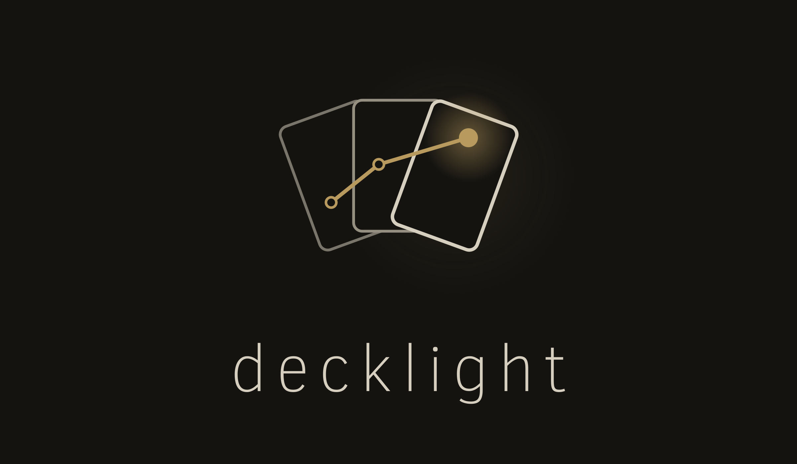

<p align="center">
  
</p>

# decklight

A Yu-Gi-Oh! duelist that pilots **any deck you give it**, including decks and cards it never trained on, and a
phone-friendly web client to play and study against it.

- **Strength:** 0.623 [0.598, 0.647] win rate against [ygo-agent](https://github.com/sbl1996/ygo-agent), an
  open-source RL agent, on ygo-agent's own 31 decks (1,488 paired games). Details in
  [docs/results.md](docs/results.md).
- **How it plays:**
  - a learned policy proposes moves;
  - a learned value net judges positions;
  - an honest search checks the policy's top moves in worlds sampled only from what the player has seen, and
    overrides the policy only on a significant difference.
- **Honest about limits:** one external benchmark, no human-strength evaluation yet, weaker going first. See
  [docs/model-card.md](docs/model-card.md).

The engine is EDOPro's (edo9300 ygopro-core). Card data and scripts come from Project Ignis. No card art is bundled.

## Quickstart (Linux, Python ≥ 3.12, [uv](https://docs.astral.sh/uv/), a C++ compiler)
```bash
git clone --recursive https://github.com/chronchi/decklight.git
cd decklight
uv sync --group dev --group ml --group web
scripts/build_ext.sh                 # builds the patched engine core and the C++ environment
scripts/fetch_release.sh             # model bundle (~68 MB) from the GitHub release, checksum-verified
uv run pytest tests/unit -q          # optional
```

### Play in the browser (phone or desktop)
```bash
uv run python scripts/web_play.py    # prints http://127.0.0.1:8765/?t=<token>
```
- Pick one of ~180 decks or paste a `.ydk`, then duel the bot.
- The client has hints, a turn recap, deck primers and puzzles.
- **Card art:** off by default; turn on "Card art" in settings to load images from YGOPRODeck.
- To reach it from your phone, use `--bind tailscale` (or any address you trust).

### Play from EDOPro
```bash
uv run python scripts/edopro_host.py --deck decks/pool/snake-eye.ydk --opponent product
```
Then join `127.0.0.1:7911` from EDOPro's LAN mode.

### Play as a bot in a Multirole room
```bash
uv run python scripts/edopro_join.py Name=bot Deck=raw-blueeyes Host=127.0.0.1 Port=7911 RoomId=12 HostInfo=<room password>
uv run python scripts/edopro_join.py --list-bots   # bundles in bots/ + config/bots/
```
On Multirole a room is joined by its id (`RoomId=`), which the server's room
listing shows (`http://<host>:7922/`, JSON: `roomid`, `roomnotes`, `users`);
`HostInfo=` is the room password, empty for an open room.
`scripts/audit/multirole_check.py` plays full duels against a running Multirole
(a room host and a joining bot) and fails on any retry or winner mismatch.
This joins a room as a bot and plays it with the raw policy over the network
(no local search: a client never sees the opponent's hidden choices, and the
product search needs the true engine state, so only `random` and `raw` agents
run here). The client also sees less than the policy saw in training (the
opponent's passes and declined chains, which hand card is which after a
shuffle), so it picks the same move as with full information on 94.5% of
decisions (`scripts/audit/client_parity.py`). Search stays on the host
(`edopro_host.py`) and web sides, which hold the engine.

A bot is a bundle: one folder with `bot.toml` (agent, deck, checkpoints,
custom cards, embeddings) — see `docs/bots.md`. `finetune_deck.py` writes one
next to every fine-tune; copy it into `bots/` to play it anywhere.

### Reproduce the benchmark
```bash
uv sync --group dev --group ml --group web --group gauntlet   # + ygo-agent's tflite runtime (uv sync is exact)
curl -fL --create-dirs -o data/models/0546_26550M.tflite \
    https://github.com/sbl1996/ygo-agent/releases/download/v0.1/0546_26550M.tflite
curl -fL -o data/models/code_list.txt \
    https://raw.githubusercontent.com/sbl1996/ygo-agent/dbf5142d49aab2e6beb4150788d4fffec39ae3e5/scripts/code_list.txt
sha256sum -c <<'EOF'
d4ad2a78b6a2a2c1a4560f8f12da6f4b3abb24735657115969e96d71a2364b10  data/models/0546_26550M.tflite
7b96f32845710b62a2f5ac1aa2a8c22e3af0ca780b5069532a06204f7dbdde78  data/models/code_list.txt
EOF
. scripts/product.sh
uv run python scripts/search_match.py --ckpt "$PRODUCT_CKPT" --value "$PRODUCT_VALUE" $PRODUCT_SEARCH \
    --opp ygoagent --ga-seeds 6 --deal-seed0 9000 --out runs/my-card
```
- That is 1,488 searched games: hours on a many-core box with a GPU (`--nproc/--proc` to shard).
- `--device cuda` needs a CUDA build of PyTorch: the project pins the CPU wheel by default.
- `scripts/audit/paired_sm.py` compares two runs on the same deals.

### Fine-tune on your deck (needs a GPU)
The bot plays every deck with one shared model. A short fine-tune on one deck makes it pilot that deck better:
```bash
uv pip install torch --index-url https://download.pytorch.org/whl/cu128    # CUDA build (the default wheel is CPU-only)
uv run --no-sync python scripts/finetune_deck.py --deck my.ydk --out runs/ft-my --hours 2
uv run --no-sync python scripts/web_play.py --ckpt runs/ft-my/policy/best.pt --value runs/ft-my/value/best.pt
```
- It continues the bot's self-play training with your deck in half the seats, and updates both the policy and
  the value head. `edopro_host.py` takes the same `--ckpt/--value`.
- Or just start `web_play.py`: fine-tunes under `runs/` (or `--models-dir`) appear in the lobby as
  "decklight's model", next to the deck they were tuned for. Hints, win chance and the review use the chosen model.
- A 16 GB card is enough (~9 GB used). 2 h is ~180 training iterations on an RTX 4060 Ti; on Blue-Eyes, 2 h gained
  about twice as much as 0.75 h (raw policy +7.9 pp vs +3.8 pp).
- **What to expect** (two decks, 0.75 h fine-tunes, product vs ygo-agent piloting the other 30 benchmark decks):
  Branded 0.61 → 0.77 (+16 pp, 95% CI +9 to +23), Blue-Eyes 0.37 → 0.44 (+8 pp, CI +1 to +15). See
  [docs/results.md](docs/results.md#fine-tuning-on-one-deck). The fine-tuned model is for that deck: use the
  base model for other decks.
- Measure your own deck with `scripts/deck_card.py` (needs the benchmark setup above): it plays the base and
  fine-tuned models on the same deals against every other benchmark deck, in both seats, and prints the paired
  difference.

## Repository map
| path | what |
|---|---|
| `src/decklight/` | the Python package: engine bindings, observations, models, search, web server, EDOPro host |
| `cpp/` | the C++ environment (pybind11) |
| `scripts/` | training, evaluation, data and audit scripts; `scripts/product.sh` defines the product |
| `web/` | the browser client (plain JS, no build step) |
| `decks/` | deck pool, ygo-agent's gauntlet decks, holdout and new-card test decks |
| `docs/adr/` | architecture decisions |
| `docs/results.md`, `docs/model-card.md`, `docs/how-it-was-built.md` | results, model card, how it was built |
| `third_party/` | submodules (ygopro-core, CardScripts, BabelCDB) and our two engine patches |

## License
AGPL-3.0 (see [LICENSE](LICENSE) and [NOTICE](NOTICE)). Yu-Gi-Oh! is a trademark of Konami; this is an unofficial,
non-commercial project.
