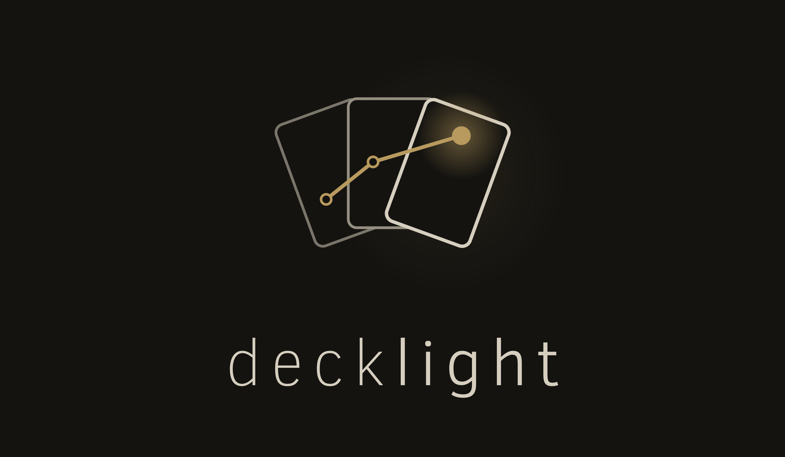

<p align="center">
  
</p>

# decklight

A Yu-Gi-Oh! app to play and study with a learned duelist that pilots **any deck you give it**, including decks and
cards it never trained on. Duel the bot or a friend, replay and export your games, check your decisions against the
bot's, and ask questions about cards, decks and your games. Duels, the bot and your games stay on your device; Ask
uses the LLM provider you pick, or a model on the device.

The engine is EDOPro's (edo9300 ygopro-core). Card data and scripts come from Project Ignis. No card art is bundled:
the app loads it from YGOPRODeck when shown, or not at all if you turn it off.

## Install on a Linux laptop
1. System packages, once (WebKitGTK for the window, a C++ compiler for the engine):
   ```bash
   sudo apt install build-essential pkg-config curl file libwebkit2gtk-4.1-dev libxdo-dev libssl-dev \
       libayatana-appindicator3-dev librsvg2-dev
   ```
   Then [Rust](https://rustup.rs) and [uv](https://docs.astral.sh/uv/), if you don't have them.
2. The source, with its submodules, and the model bundle (checksum-verified):
   ```bash
   git clone --recursive https://github.com/chronchi/decklight.git
   cd decklight
   scripts/fetch_release.sh
   ```
3. Build and install the app for your user (no sudo):
   ```bash
   rust/app/install_linux.sh
   ```
   decklight then shows up in your app menu. The app lives in `~/.local/share/decklight/`. The build cache is deleted
   afterwards (`--keep-build` keeps it for faster rebuilds).

Android: `rust/app/build_android.sh` builds the APK (a developer build for now). Other ways to play, from EDOPro or as a
bot in a room: [docs/guide/bots.md](docs/guide/bots.md).

## The bot
A learned policy proposes moves and a learned value net judges positions. On top of them, an honest search samples only
worlds consistent with what the player has seen. It checks the policy's top moves there and overrides the policy only
on a significant difference.

It was trained in stages:
1. behaviour cloning on self-play games of an open-source agent and on combo lines checked move by move in the engine;
2. self-play RL on ~180 deck lists, with a second search bot among the opponents and extra training on the
   opponent's turn (hand traps, chains);
3. the **Forge**: short per-archetype fine-tunes (specialists) distilled back into one shared model, so every deck
   gains without a model per deck (two rounds so far).

Card embeddings from card text let it play cards it has never seen.

- Train it further on your deck, or contribute a specialist to the next Forge release:
  [docs/guide/forge.md](docs/guide/forge.md).
- What it is good and bad at: [model card](docs/model/model-card.md). Measured results:
  [docs/model/results.md](docs/model/results.md).

## More
- [docs/](docs/README.md): guides, the model, design specs and architecture decisions.
- Code: `src/decklight/` (Python: training, evaluation, search), `rust/` (the app's engine bindings, search and local
  server), `web/` (the client, plain JS), `cpp/` (the C++ training environment), `decks/` (the deck pool and test decks).

## License
AGPL-3.0 (see [LICENSE](LICENSE) and [NOTICE](NOTICE)). Yu-Gi-Oh! is a trademark of Konami; this is an unofficial,
non-commercial project.
